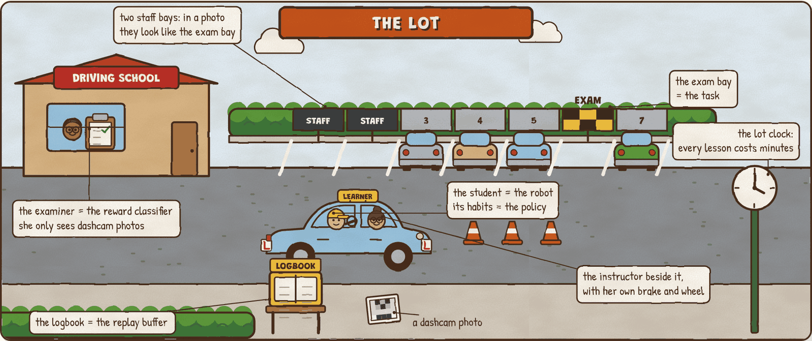
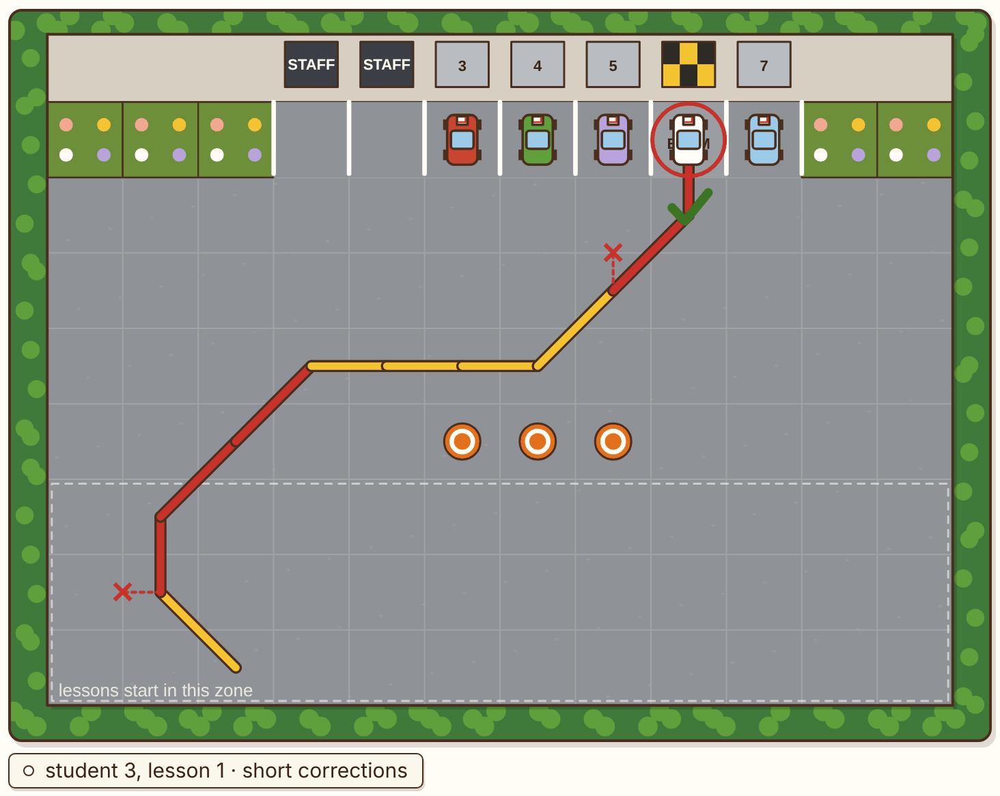

# Dual Controls

**A hands-on lab for how robots learn by trial and error on real hardware, with a human in the loop.** Teach a student driver to park by reinforcement on a real lot where every lesson costs minutes: keep every move in a logbook and study it again and again, let an examiner who only sees dashcam photos pay the reward (and find her false passes), put the instructor's own drives in half of every study batch, and let her grab the dual controls, briefly, just before a mistake.

**Play it: https://bakulbadwal.github.io/policy-pond/dual-controls/**

*Step 5, a lesson with short corrections: yellow is the student, red is the instructor's three-move takeover, and each ✕ marks the move the student was about to make.*

A driving school teaches parking on a small lot. The **student driver** is the robot and its habits are the **policy**; the **examiner**, who never watches the drive and only gets a 5 × 4-pixel dashcam photo every second, is the learned **reward classifier**; the **logbook** of every move is the **replay buffer**; the **instructor's own drives** are the **demonstrations**; her **second brake and wheel** are **human interventions**; the **dither dial** is SAC's **temperature**; the **fence inside the hedge** is the **workspace bounds**, and the **lot clock** is the wall clock that real-world RL is measured in. Hold that picture and the real-world RL part of Hugging Face's [*Robot Learning* tutorial](https://arxiv.org/abs/2510.12403) (§3) and the [HIL-SERL](https://arxiv.org/abs/2410.21845) paper follow.

## What's inside

| Step | You play with | What clicks |
|---|---|---|
| **0 · The Lot** | The untrained student's lessons, animated, with the (s, a, r, s′, done) logbook page for every move; 2,000 lessons in one click | A sparse reward is almost never seen: 8 parks in 2,000 random lessons, 95% crashes, 26 hours of lot time |
| **1 · Every Lesson Twice** | REINFORCE (on-policy) against SAC (off-policy) on a practice task, 8 students each, plotted against lot time; SAC's study batches per move (UTD 1, 4, 16) | The same lot time buys far more learning when every move is replayed: 75% at lesson 253 for SAC (each move studied 63×) vs 557 for REINFORCE. Four times the study per move barely helps (243): the logbook is the limit |
| **2 · The Soft Critic** | Three real logbook pages, with the soft Bellman target built term by term; the dither dial, π ∝ exp(Q/α); four temperature settings; the slow target copy at three speeds | A temperature stuck at 1 pays more for dithering than parking pays (4% on the exam, against 82% when α is tuned). In a table the slow copy only slows learning; it's there for networks |
| **3 · The Examiner** | Her training photos; train her (logistic regression on 20 pixels); a threshold; her verdict on four poses; let her pay 8 students; photograph her false passes and retrain | 100% on a fresh test set, and she passes every straight park in a staff bay. Students paid by her park next door on 36% of exams while her clipboard says 85% passed (truly 49%). Thirty extra negatives fix it: 81% by either grader |
| **4 · The Instructor's Drives** | 0 to 30 demo drives in a second logbook, half of every batch (RLPD's symmetric sampling); 8 students each | First park: lesson 167 with no demos, 22 with 20. No student reaches 80% without demos; with 30, seven of eight do |
| **5 · Dual Controls** | Six instructor styles, from no help to the backseat driver; her takeovers drawn in red on the lot, with the move the student wanted; the intervention rate falling | Short corrections (3 moves, only when it's about to fail): 80% at lesson 11 instead of 150, for 3 minutes of her driving, rate 31% → 2%. The backseat driver: 11.6 minutes and still 40% at the end |
| **6 · The Real Lot** | Workspace bounds (a fence inside the hedge), reset times, everything plotted against the clock | The fence turns 107 crashes into 18 and saves lot time; slower resets don't change the lesson count, only the minutes (80 → 129 at 30-second resets) |
| **★ Review Board** | Three failed runs: the student who parks next door, the dawdler, the backseat driver. Pick a fix, re-run 8 students, name the cause | The tempting fixes (raise the threshold, more demos, longer takeovers) fail for the reason the step taught |
| **✓ Field Test** | Ten questions answered by operating the widgets | Proof it stuck |

Each step has predict-then-reveal questions and a "say it out loud" line that unlocks once you've played. Every term has a tooltip with its plain meaning and its driving-school equivalent. Progress is saved in your browser.

## Why this one

The interactive RL explainers are about learning in a simulator: Karpathy's REINFORCEjs and the gridworld demos, the Flowers lab's [interactive deep RL demo](https://flowers-team-interactive-deeprl-demo.static.hf.space/) (SAC-trained walkers in the browser), and this series' own [Policy Pond](https://bakulbadwal.github.io/policy-pond/) (REINFORCE, PPO, GAE) and [Reward Arcade](https://bakulbadwal.github.io/reward-arcade/) (environments and reward design). HIL-SERL is explained in its paper, the tutorial and LeRobot's guide, all static. I didn't find anything that lets you count the real minutes, train a reward classifier and watch a policy farm its false positives, compare demos and interventions on the same seeds, and see the intervention rate fall. That's this lab. It also covers the material after Unit 2 of the [Hugging Face Robotics Course](https://huggingface.co/learn/robotics-course), whose later units aren't published yet.

## Run it

Play it live at the link above, or open `index.html` in a browser. There's no build step, no dependencies, and nothing to install. `node tests/check.js` runs the checks and prints every number in [`ACCEPTANCE.md`](ACCEPTANCE.md) (about 80 s).

## What's exact and what's a model

- **The real algorithms:** soft actor-critic in its discrete form (Christodoulou 2019): the exact soft Bellman target, the actor loss and the temperature loss, with automatic temperature tuning to a target entropy, Adam on the actor and on log α, and a slow target copy updated by Polyak averaging after every step; a replay buffer studied at an update-to-data ratio; RLPD's symmetric sampling; HIL-SERL's buffering (interventions into both buffers, the student's moves into the online one only) and its intervention rate; a binary reward classifier (logistic regression) with a threshold and terminate-on-success; REINFORCE with a baseline as the on-policy comparison. Every gradient is checked against finite differences, and the Bellman target against a hand computation, in `tests/check.js`.
- **Teaching models, labelled on the page:**
  - The lot (12 × 8 squares, 8 headings, three moves), its timings (one move = 1 second; resets of 10 seconds, or 45 after a crash), and the dashcam (a 5 × 4 greyscale photo with pixel noise and a lighting shift) are hand-designed.
  - The instructor is a shortest-path planner that knows when a move will fail; on her demo drives she tries a safe detour 30% of the time (when one exists).
  - The critic and actor are tables, not networks: no LayerNorm or critic ensembles (RLPD), no twin critics (SAC), no overestimation of the kind HIL-SERL warns about. The actor updates instantly, not every few seconds over the network.
- **The directions are real; the lot isn't a robot.** Nothing here predicts how long a real HIL-SERL task takes.

Every figure quoted from a paper or LeRobot's code is in [`SOURCES.md`](SOURCES.md) with its section. Every run is seeded, so it's the same for everyone.

## Sources

- Luo, Xu, Wu & Levine, [*Precise and Dexterous Robotic Manipulation via Human-in-the-Loop Reinforcement Learning*](https://arxiv.org/abs/2410.21845) (HIL-SERL, 2024): the spine
- Capuano et al., [*Robot Learning: A Tutorial*](https://arxiv.org/abs/2510.12403) (2025), §3
- The [LeRobot HIL-SERL guide](https://huggingface.co/docs/lerobot/hilserl) and code (`src/lerobot/rl`)
- Haarnoja et al., [*Soft Actor-Critic Algorithms and Applications*](https://arxiv.org/abs/1812.05905) (2018); Christodoulou, [*Soft Actor-Critic for Discrete Action Settings*](https://arxiv.org/abs/1910.07207) (2019)
- Ball, Smith, Kostrikov & Levine, [*Efficient Online Reinforcement Learning with Offline Data*](https://arxiv.org/abs/2302.02948) (RLPD, 2023)

## The series

[Inference Kitchen](https://bakulbadwal.github.io/inference-kitchen/) (serving) · [Finishing School](https://bakulbadwal.github.io/finishing-school/) (post-training) · [Arm Playground](https://bakulbadwal.github.io/arm-playground/) (kinematics and control) · [Policy Pond](https://bakulbadwal.github.io/policy-pond/) (reinforcement learning) · [Reward Arcade](https://bakulbadwal.github.io/reward-arcade/) (environments and evals) · [Fork in the Road](https://bakulbadwal.github.io/fork-in-the-road/) (diffusion policies) · [Duck's-Eye View](https://bakulbadwal.github.io/ducks-eye-view/) (robot vision) · [Wet Paint](https://bakulbadwal.github.io/wet-paint/) (imitation learning) · **Dual Controls** (real-world RL with a human in the loop)

MIT licensed. Built by [Bakul Badwal](https://www.linkedin.com/in/bakulbadwal/) with Claude Code.
